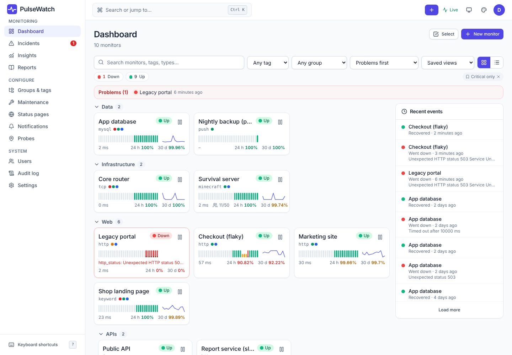
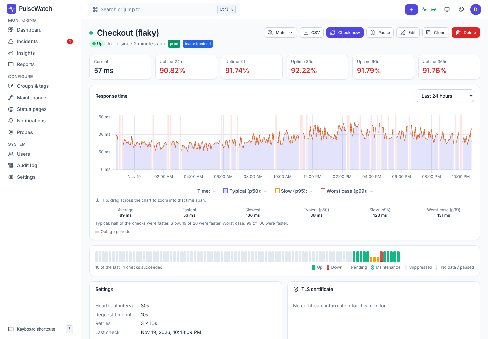
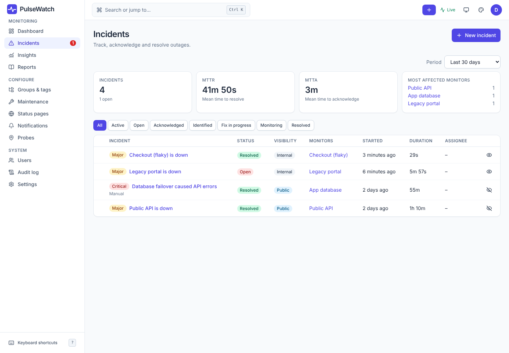
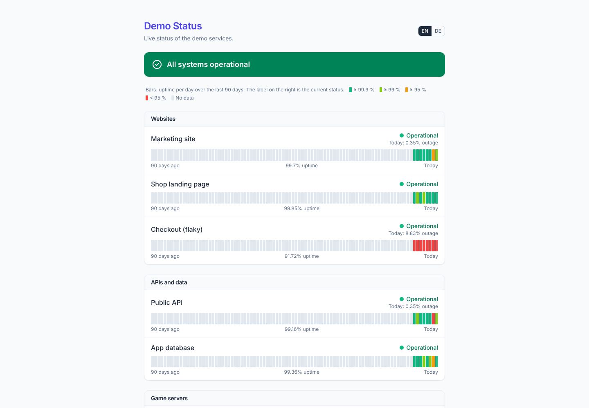
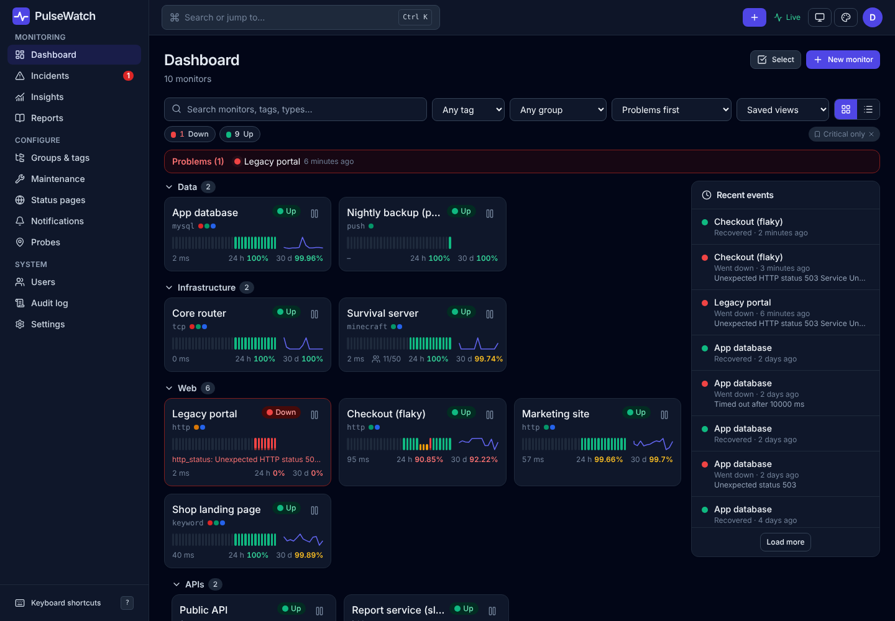
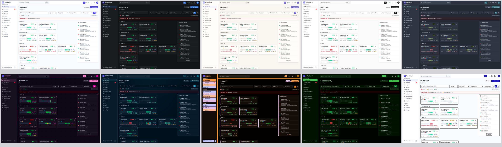
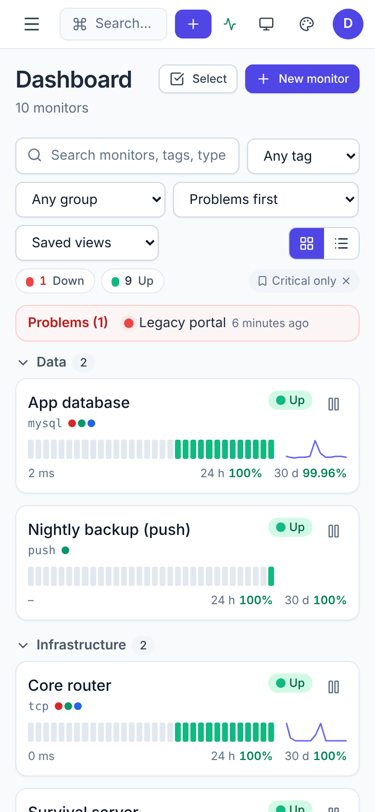
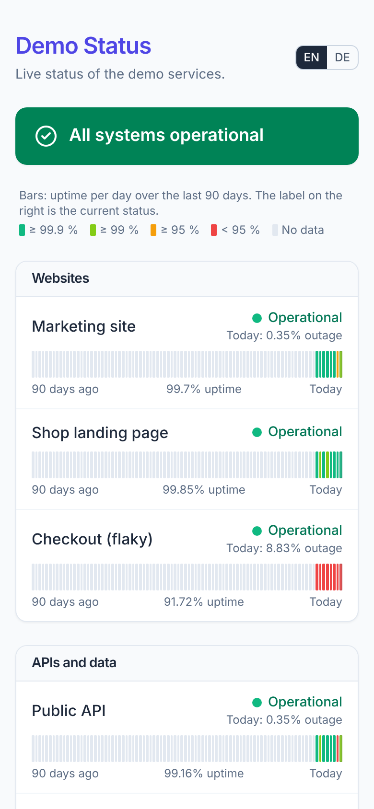

# PulseWatch

Self-hosted uptime and status monitoring. Think Uptime Kuma, but built on MariaDB, with multi-location probes, roles and permissions, SSO, long-term rollups and a modern UI.

Copyright (c) PD-Codes. Licensed under [GPL-3.0-only](LICENSE). No telemetry, no phone-home.

<p align="center">
  
</p>

- [Quick start](#quick-start)
- [Features](#features)
- [Screenshots](#screenshots)
- [Configuration reference](#configuration-reference)
- [Architecture](#architecture)
- [Probes (multi-location checks)](#probes-multi-location-checks)
- [Working with many monitors](#working-with-many-monitors)
- [Status page history and groups](#status-page-history-and-groups)
- [Certificates and TLS errors](#certificates-and-tls-errors)
- [Single sign-on with SAML (Entra ID)](#single-sign-on-with-saml-entra-id)
- [Backup and restore](#backup-and-restore)
- [Upgrading](#upgrading)
- [Importing from Uptime Kuma](#importing-from-uptime-kuma)
- [Config as code](#config-as-code)
- [Security notes](#security-notes)
- [Development and tests](#development-and-tests)
- [Tested limits](#tested-limits)
- [Surprise features](#surprise-features)
- [Known limitations](#known-limitations)

## Quick start

Requirements: Docker with Compose v2.

```bash
cp .env.example .env
# edit .env: set PW_DB_PASSWORD and PW_BASE_URL (and ideally PW_SECRET_KEY)
docker compose up -d
```

This pulls the official multi-arch images (amd64 and arm64) from ghcr.io: `ghcr.io/pd-codes/pdc-pulsewatch` (app) and `ghcr.io/pd-codes/pdc-pulsewatch-probe` (remote probe). Every release is tagged `<version>` (for example `0.4.1`), `<major>.<minor>`, `<major>` and `latest`; pre-releases only get their exact version tag. To stay on a release line set `PW_IMAGE=ghcr.io/pd-codes/pdc-pulsewatch:0.4` in `.env`.

To build from this checkout instead (for local changes), add the build override file:

```bash
docker compose -f docker-compose.yml -f docker-compose.build.yml up -d --build
```

It tags the images `pulsewatch-local/app` and `pulsewatch-local/probe` and never pulls. To use it with plain `docker compose` commands, put `COMPOSE_FILE=docker-compose.yml:docker-compose.build.yml` in `.env`.

Open `http://localhost:3000`. The first visit shows the setup page where you create the administrator account. As long as no administrator exists, the page asks for a **setup token**, so nobody who finds a fresh installation first can claim it: set `PW_SETUP_TOKEN` in `.env`, or read the one-time token PulseWatch writes to the log on the first start (`docker compose logs app | grep -i "setup token"`). See [Security notes](#security-notes).

Want to look around first? Start with sample data (10 monitors, 90 days of history, a status page at `/status/demo`):

```bash
PW_DEMO=true PW_DEMO_PASSWORD=demo-demo-1 docker compose up -d
# sign in as admin / demo-demo-1
```

Demo mode seeds once, creates its own administrator (no setup token) and must not be enabled on a production database.

Behind a reverse proxy, set `PW_BASE_URL=https://your.host` and `PW_TRUST_PROXY=1` (the number of proxies in front of the app; see [Security notes](#security-notes) for the other forms). If the proxy runs on the same host, also set `PW_BIND=127.0.0.1` so the app port is not reachable from outside. The base URL is used for links in mails, OIDC callbacks and passkeys. Server-sent events need response buffering turned off (nginx: `proxy_buffering off;` for `/api/stream`).

Useful endpoints: `/health` (liveness), `/ready` (database and scheduler), `/metrics` (Prometheus, see `PW_METRICS_TOKEN`), `/api/docs` (OpenAPI/Swagger UI, sign-in required), `/api/push/<token>` (heartbeats).

## Features

**Monitoring:** HTTP(S) with method/headers/body/auth/status codes/redirects/TLS toggle, keyword and JSON path checks, multi-step HTTP flows, TCP, ICMP ping, UDP, DNS, TLS certificate expiry (with chain), domain/WHOIS expiry, SMTP, IMAP/POP3, SSH banner, SFTP (password or key login, optional pinned host key, file or directory presence, minimum size and maximum age), WebSocket, gRPC, MQTT, SNMP, NTP (clock offset), RADIUS, LDAP, FTP/FTPS, RDP, SIP, RabbitMQ, Kafka, MariaDB/MySQL, PostgreSQL, MSSQL, Oracle, Redis, MongoDB, Docker container state, PM2 processes, Globalping (ping/HTTP from a chosen country or city), game servers (Minecraft, Steam/Source, about 350 more through GameDig, Pelican/Pterodactyl panels, CubeCoders AMP) and push/heartbeat and manual-status monitors. Every monitor has interval, timeout, retries, up/down thresholds, flap detection, tags, groups, pause/clone/bulk edit and notification rules. Failure modes (DNS, refused, timeout, TLS, wrong status, ...) are distinct error kinds in the event log.

**Operations:** nested groups with dependencies (children are suppressed while a parent is down), automatic and manual incidents with six statuses (open, acknowledged, identified, being fixed, monitoring, resolved), groups as incident scope, assignee, notes, post-mortem and MTTR/MTTA, maintenance windows (once or cron, timezone-aware, effective to the second), alert snooze (1 h, 4 h or until tomorrow, on a monitor or an incident), a service level objective (SLO) per monitor with the remaining error budget and a notification when it is used up, status pages (custom domain, branding, custom CSS, per-page theme, password or login protection, email/RSS/webhook subscriptions).

**Notifications:** email, Telegram, Discord, Slack, Microsoft Teams, ntfy, Gotify, Pushover and templated webhooks (plus a plugin hook, `registerChannelType`). Templates, escalation policies, quiet hours, per-channel test button and a delivery log with retry.

**Security and users:** local accounts, OIDC (Entra ID, Keycloak, Google, ...), SAML 2.0 (Entra ID), LDAP, TOTP, passkeys (WebAuthn), API tokens with scopes, session management, audit log, roles plus per-group and per-status-page permissions.

**Data:** raw heartbeats roll up to minute, hour and day aggregates (exact percentiles per minute); raw data lives in daily partitions that are dropped by retention. Charts stay fast over years.

**Reports and integrations:** SLA reports as PDF/CSV (also scheduled by mail), CSV export of heartbeats and events on the monitor page, daily digest, Prometheus metrics, outgoing webhooks, OpenAPI, Kuma import, YAML/JSON config export and import.

**UI:** ten themes (Classic, Dark, Smooth, Monochrome, Nord, Cyberpunk, Sci-Fi, LCARS, Terminal, High contrast), chosen per device with an instance default in Settings, German and English (browser language or profile setting), responsive down to phone width, installable PWA, command palette (`Ctrl/Cmd+K`), keyboard shortcuts (`?` lists them), kiosk mode at `/kiosk` with presets and read-only keys for screens without a login, browser notifications (with an optional sound) for outages while a tab is open, 20 rows per page in every list, a hint when a newer version is available, reduced-motion support.

## Screenshots

Captured in demo mode (`PW_DEMO=true`): 10 sample monitors and 90 days of generated history.

<table>
  <tr>
    <td width="50%"><br><sub><b>Monitor detail</b> — response time with percentiles, outage periods and uptime per window.</sub></td>
    <td width="50%"><br><sub><b>Incidents</b> — status workflow, MTTR and MTTA.</sub></td>
  </tr>
  <tr>
    <td width="50%"><br><sub><b>Status page</b> — public, with 90 days of history per service.</sub></td>
    <td width="50%"><br><sub><b>Dark mode</b> — light, dark or follow the system.</sub></td>
  </tr>
</table>

Ten themes, chosen per device (top bar or profile), with an instance default under *Settings > Appearance*, a theme per status page and `?theme=` for kiosk screens:

<p align="center">
  
  <br><sub>Classic · Dark · Smooth · Monochrome · Nord (top) — Cyberpunk · Sci-Fi · LCARS · Terminal · High contrast (bottom)</sub>
</p>

Responsive down to phone width:

<p align="center">
  
  &nbsp;
  
</p>

## Configuration reference

Everything is configured through environment variables. Any variable also accepts a `_FILE` variant that reads the value from a file (Docker secrets), e.g. `PW_DB_PASSWORD_FILE=/run/secrets/db`.

### Core

| Variable | Default | Description |
| --- | --- | --- |
| `PW_ROLE` | `all` | `all`, `api` (HTTP only) or `worker` (scheduler, rollups, notifications only). |
| `PW_HOST` | `0.0.0.0` | Listen address. |
| `PW_PORT` | `3000` | Listen port. |
| `PW_BASE_URL` | `http://localhost:3000` | Public URL. Used for links, OIDC redirects, passkey origin. `https://` also turns on secure cookies. |
| `PW_TRUST_PROXY` | `false` | Trust `X-Forwarded-*` from a reverse proxy (client IPs, rate limits, lockouts). `false`, `true` (every hop, clients can forge their address, logs a warning at start), a number of proxy hops (1-32, recommended) or comma separated proxy IPs/CIDRs. Anything else stops the start. |
| `PW_LOG_LEVEL` | `info` | pino log level. Logs are JSON on stdout. |
| `PW_TIMEZONE` | `UTC` | IANA time zone (for example `Europe/Berlin`) that defines the day for daily rollups, the heatmap, day bars and reports. Use the same value for every container. Changing it rebuilds the daily rollups from the hourly ones at the next start. |
| `PW_SHUTDOWN_GRACE_MS` | `20000` | Total time a stop (SIGTERM) may take: running checks, releasing leases, closing HTTP and the database. Keep it below the orchestrator's stop timeout (30 s in the compose file). |
| `PW_DATA_DIR` | `./data` (`/data` in the image) | Holds the generated secret key when `PW_SECRET_KEY` is not set. |
| `PW_WEB_DIR` | `./dist/web` | Built UI. |
| `PW_MIGRATIONS_DIR` | `./migrations` | SQL migrations, applied at startup under a database lock. |

### Database

| Variable | Default | Description |
| --- | --- | --- |
| `PW_DB_HOST` | `127.0.0.1` | MariaDB host (`mariadb` in the compose file). |
| `PW_DB_PORT` | `3306` | MariaDB port. |
| `PW_DB_NAME` | `pulsewatch` | Database name. |
| `PW_DB_USER` | `pulsewatch` | Database user. |
| `PW_DB_PASSWORD` | empty | Database password (required by the compose file). |
| `PW_DB_POOL` | `20` | Connection pool size. |

### Secrets and security

| Variable | Default | Description |
| --- | --- | --- |
| `PW_SECRET_KEY` | generated | Master key for encrypting secrets at rest (AES-256-GCM) and signing cookies. If unset, a key file is created in `PW_DATA_DIR`. **Back it up together with the database**, encrypted values cannot be recovered without it. Generate one with `openssl rand -base64 32`. |
| `PW_SESSION_TTL_HOURS` | `168` | Session lifetime. |
| `PW_COOKIE_SECURE` | from `PW_BASE_URL` | Force the `Secure` cookie flag. |
| `PW_SETUP_TOKEN` | generated | Token the setup page asks for while no administrator exists. Unset: a one-time token is generated on the first start and written to the log. |
| `PW_SSRF_MODE` | `allow-private` | `allow-private` or `public-only`; checked at start, any other value stops it. Can be overridden at runtime in Settings. |
| `PW_SSRF_ALLOW` | empty | Comma separated IPs/CIDRs exempt from `public-only`. |
| `PW_SSRF_DENY` | empty | Comma separated IPs/CIDRs that are always blocked, in addition to the built-in list of cloud metadata addresses (see [Security notes](#security-notes)). |
| `PW_RATE_LIMIT_MAX` | `300` | API requests per minute per client. Static assets and health endpoints are exempt. |
| `PW_RATE_LIMIT_LOGIN` | `10` | Login attempts per minute per client. |
| `PW_METRICS_TOKEN` | empty | Bearer token for `/metrics`. Without it only signed-in administrators can read it. |

### Scheduler and retention

| Variable | Default | Description |
| --- | --- | --- |
| `PW_TICK_MS` | `1000` | Scheduler tick. |
| `PW_MAX_CONCURRENCY` | `200` | Maximum checks running at once. |
| `PW_JITTER_PCT` | `5` | Random spread of the interval, avoids thundering herds. |
| `PW_RETENTION_RAW_DAYS` | `14` | Raw heartbeats (dropped by partition). |
| `PW_RETENTION_MINUTE_DAYS` | `60` | Minute rollups. |
| `PW_RETENTION_HOUR_DAYS` | `400` | Hour rollups. |
| `PW_RETENTION_DAY_DAYS` | `3650` | Day rollups. |
| `PW_RETENTION_EVENT_DAYS` | `365` | Event log. |
| `PW_RETENTION_AUDIT_DAYS` | `730` | Audit log. |

### Email, monitoring of PulseWatch itself, tracing

| Variable | Default | Description |
| --- | --- | --- |
| `PW_SMTP_HOST` / `PW_SMTP_PORT` | empty / `587` | SMTP server for digests, reports and subscription mails. Alert emails use the per-channel SMTP settings. |
| `PW_SMTP_USER` / `PW_SMTP_PASS` | empty | SMTP credentials. |
| `PW_SMTP_FROM` | `PulseWatch <pulsewatch@localhost>` | Sender address. |
| `PW_SMTP_SECURE` | `false` | Implicit TLS (port 465). |
| `PW_DEADMAN_URL` | empty | URL pinged every `PW_DEADMAN_INTERVAL` seconds while the scheduler is healthy. Point it at a push monitor of another PulseWatch (or any heartbeat service) to be alerted when this instance dies. |
| `PW_DEADMAN_INTERVAL` | `60` | Seconds between pings. |
| `PW_OTEL_EXPORTER_OTLP_ENDPOINT` | empty | OTLP/HTTP endpoint (for example `http://collector:4318`). When set, every monitor check is exported as a span to `/v1/traces`. |

### Demo

| Variable | Default | Description |
| --- | --- | --- |
| `PW_DEMO` | `false` | Seed sample data on first start and expose demo target endpoints under `/demo/*`. |
| `PW_DEMO_PASSWORD` | random, logged | Password of the demo `admin` user. |

### Probe agent

| Variable | Default | Description |
| --- | --- | --- |
| `PW_SERVER_URL` | required | Base URL of the PulseWatch server. Must be `https://` (see below). |
| `PW_PROBE_TOKEN` | required | Token shown once when the probe is created. |
| `PW_PROBE_FETCH_SECONDS` | `30` | How often the job list is refreshed. |
| `PW_PROBE_CONCURRENCY` | `50` | Maximum parallel checks. |
| `PW_PROBE_SSRF_MODE` / `_ALLOW` / `_DENY` | `allow-private` | Same semantics as the server variables, applied on the probe. |
| `PW_PROBE_ALLOW_INSECURE` | `false` | Permit a plain `http://` server URL. Only for tests. |

### Docker Compose variables

The compose file passes all `PW_RETENTION_*` variables, `PW_SETUP_TOKEN`, `PW_TIMEZONE` and `PW_SHUTDOWN_GRACE_MS` through. `PW_IMAGE` and `PW_PROBE_IMAGE` (default `ghcr.io/pd-codes/pdc-pulsewatch:latest` and `ghcr.io/pd-codes/pdc-pulsewatch-probe:latest`), `PW_PUBLIC_PORT` (host port, default 3000), `PW_BIND` (host address of that port, default `0.0.0.0`; use `127.0.0.1` behind a reverse proxy on the same host) and `PW_DB_BUFFER_POOL` (MariaDB InnoDB buffer pool, default 256M) only affect the compose file. The containers get 30 s to stop (`stop_grace_period`).

## Architecture

```
 browser (React SPA, SSE) ──► app (Fastify API + scheduler + jobs) ──► MariaDB 11
                                   ▲
 probe agents (pull jobs, push results over HTTPS) ┘
```

- **One process by default.** `PW_ROLE=all` runs API, scheduler, rollups, report jobs and the notifier. For bigger setups run `PW_ROLE=api` replicas behind a load balancer and one or more `PW_ROLE=worker` containers (`docker compose --profile split up -d`). Everything coordinates through MariaDB: due checks are claimed with `SELECT ... FOR UPDATE SKIP LOCKED` and a lease, so two workers never run the same check and a crash just lets the lease expire. Redis is not needed.
- **Scheduler** (`src/server/engine`): persisted `next_run_at` per monitor, jitter, concurrency cap, per-check hard timeout, graceful shutdown (`PW_SHUTDOWN_GRACE_MS`). A restart neither loses nor duplicates rounds, and checks spread over the whole interval again after a restart.
- **Check runners** (`src/core/runners`): every monitor type is a self-contained runner with a field definition (drives the UI form and server validation) and a `run()` function. Add a type with `registerRunner`.
- **State machine** (`engine/machine.ts`): retries (how many), "report as down after", up threshold, flap detection (off by default, as in Uptime Kuma), dependency suppression, maintenance overlay, multi-location quorum. Pure and unit-tested.
- **Data** (`migrations/`): versioned SQL migrations. `heartbeats` is partitioned by day; `rollups` holds minute, hour and day aggregates; secrets are stored as `enc:v1:` ciphertext.
- **Realtime:** server-sent events (`/api/stream`), the UI patches its query cache, there is no polling.
- **Notifications** (`src/server/notify`): event bus, per-monitor rules, quiet hours, escalation policies, an outbox for deliveries (a crash does not lose notifications) with retries and a log.
- **Auth** (`src/server/auth`): scrypt passwords, TOTP, passkeys, OIDC, LDAP, bearer tokens with scopes, CSRF token bound to the session, audit log.
- **Frontend** (`web/`): React 19, Vite, Tailwind, TanStack Query, uPlot. English and German strings live in `web/src/locales`, the ten themes in `web/src/themes`.
- **Runtime:** Node.js 26. The image starts Node with V8's fallback regex engine (`--enable-experimental-regexp-engine-on-excessive-backtracks`) so a pathological regular expression cannot freeze a check, and raises the libuv thread pool (`UV_THREADPOOL_SIZE=64`) because DNS lookups run on it.
- **Why Node.js and not Go?** The scheduler is I/O bound (sockets, HTTP, DNS), which Node's event loop handles well: 5,000 monitors at 30 s run at about 165 checks per second on 2 vCPUs, see [Tested limits](#tested-limits). One language across API, runners, probe and UI keeps the project small. If you ever need hundreds of thousands of monitors, the probe protocol is simple enough to reimplement the agent in Go.

## Probes (multi-location checks)

A probe is a small agent (`Dockerfile.probe`) that runs checks from another network and reports back. It only makes outbound connections.

1. In the UI open **Probes** and create a probe. Copy the token, it is shown only once.
2. Run the agent on the remote host:

   ```bash
   docker run -d --restart unless-stopped --name pulsewatch-probe \
     -e PW_SERVER_URL=https://pulsewatch.example.com \
     -e PW_PROBE_TOKEN=pwp_... \
     --cap-drop ALL --cap-add NET_RAW --read-only \
     ghcr.io/pd-codes/pdc-pulsewatch-probe:latest
   ```

   Or with this repository: `PW_PROBE_TOKEN=pwp_... PW_SERVER_URL=https://... docker compose --profile probe up -d probe` (add `-f docker-compose.build.yml` to build it locally).
3. Edit a monitor, choose its locations (server and/or probes) and set the quorum: the monitor is only down when at least that many locations fail.

**Use HTTPS between probe and server.** Job payloads contain decrypted monitor credentials so the probe can authenticate against your targets. The agent refuses a plain `http://` server URL unless it points to localhost or `PW_PROBE_ALLOW_INSECURE=true`. Tokens can be rotated or a probe disabled at any time without touching monitors.

Probe results are stored when they arrive. The combined verdict for a monitor is evaluated on its normal schedule (and on "Check now"), so a probe-only monitor reacts within one interval.

## Working with many monitors

- **Dashboard views:** *Cards* (history bar, sparkline and uptimes per monitor), *Groups* (one block per group with its worst status, counts and mean 24-hour availability, collapsible), *Table* (sortable, 10 to 100 rows per page or *All*), *Status wall* (every monitor as a small colored tile, nothing paged) and *Last 24 hours* (one row per monitor, one cell per hour, colored by availability, with the numbers in the tooltip). Cards, table, wall and heatmap can be split by group with the button next to the view switcher. The view is part of the address (`/dashboard?display=wall&grouped=1`) and of saved views, and each device remembers its last choice.
- **Dashboard:** a click anywhere on a card or row opens the monitor. The pause/resume button on each card acts at once (and rolls back if the server refuses). *Select* shows checkboxes, *Select all shown* picks everything the current filter lists.
- **Bulk add:** on *New monitor* switch on *Add several monitors at once*, then paste one target per line (`name | address`, `name; address`, a tab-separated pair from a spreadsheet, or just the address). A live preview marks duplicate names; everything else on the form is shared. Lines that fail validation stay in the box so you can fix and resend them.
- **Bulk edit:** timings, retries, thresholds, flapping, group, public badge, tags (add/remove) and notification rules (add or replace) for all selected monitors. Fields left on *keep* are not touched.
- **Tags:** two kinds. *Simple tags* are just a name (click to attach). *Tags with a value* have a name and a value (`env: production`, the model Uptime Kuma uses); both fields are dropdowns that end with *Add new...*, which opens a small dialog. A monitor can carry the same name with several values. Chips show `name: value`, the dashboard search finds values, *Groups & tags* lists the values in use with their counts, and export/import and the Kuma import keep them (`tags: [simple, {name: env, value: production}]` in YAML/JSON).
- **Recent checks filter:** the *Recent checks* card on a monitor has a status dropdown with multiple selection. It lists only the statuses that monitor has produced lately (up, down, pending, maintenance, suppressed) and filters all pages, not just the visible one.
- **Latency statistics:** the chart and the report use plain names with a tooltip: *Typical (p50)* is the median, *Slow (p95)* means 19 of 20 checks were faster, *Worst case (p99)* means 99 of 100 were faster.
- **Retries, timeout and intervals work like in Uptime Kuma.** *Heartbeat interval* is how often a monitor is checked. When a check fails (a timeout and an unreachable host alike), the monitor turns *pending* and is checked again after the *Heartbeat retry interval*, up to *Retries* times; only when the last retry fails it is *down* and the notification goes out. A success in between starts over silently, and a monitor that is already down stays on the regular interval. `0` retries reports a failure right away. *Request timeout* is how long one check may take. New monitors start like in Kuma: timeout 80% of the interval (48 s at 60 s), retry interval equal to the interval. The form keeps them tied the same way: the retry interval follows the interval while both are equal, and a timeout above 80% of the interval is cut back when you leave the field. It also shows the worst case until a monitor is reported as down, and a pending check says which retry follows. Not part of Kuma and left out: choosing which errors are retried. Different from Kuma: *Up threshold* (successes in a row before a down monitor is up again, default 1 = like Kuma) and no *Resend notification if down X times* (escalation policies repeat alerts). This replaces the former pair *retries* and *down threshold*; on upgrade the migration folds them into one number so every monitor keeps its timing (`down threshold x (retries + 1) - 1`, capped at 100), and old exports and saved defaults are converted the same way on import.
- **Defaults:** *Settings > Defaults* sets the timings, retries and thresholds that pre-fill new monitors and apply when an API call or import omits them. Existing monitors are not changed.
- **Inline group:** the folder button next to *Group* creates a (sub)group without leaving the form.
- **Incident badge:** the menu shows the number of open incidents nobody has acknowledged; the same number prefixes the browser tab title. The top bar has a **+** button for a new monitor.

## Home page and sign-in

Mark a status page as *home page* (status page list, *Use as home page*) and it is served at `/` for everyone. The admin UI stays reachable at `/dashboard` and `/admin`, which ask for a login. Without a home page `/` goes to the dashboard as before. Only one page can be the home page; setting another one moves the mark. A page that is not public is never used. A status page with its own domain is the start page on that domain; `/dashboard`, `/admin` and `/login` still work there.

## Incidents

An incident moves through *open*, *acknowledged*, *identified*, *being fixed*, *monitoring* and *resolved*; any status can follow any other one, and reopening clears the end time. In the incident dialog you can pick a whole monitor group instead of ticking every monitor. **One switch decides what visitors see:** *Show on status pages* on the incident (the eye button in *Incidents* does the same). It is off by default: new incidents stay internal, and so do the incidents PulseWatch opens by itself when a monitor goes down. To publish those right away, turn on *Show detected incidents on status pages* in *Settings > Incidents*. An incident that is shown appears on the status pages and the RSS feed, and subscribers get its status changes by email; one that is not shown appears nowhere and nothing is sent. Each timeline entry has its own visibility: status changes and the resolution are always shown, a plain note is internal unless you tick *Show on the status page* when you add it. Entries written by people can be edited afterwards, text and visibility alike (*Edit* below the entry; edited entries carry an *edited* label, also for visitors). Entries PulseWatch writes itself (detected, assigned, acknowledged) cannot be edited, and the public page only says that a post-mortem was written, never what it says. Auto-resolve (the monitor recovered) leaves an incident in *monitoring* alone until someone resolves it; if the monitor fails again while monitoring, the incident reopens.

## Status page history and groups

In the status page editor an announcement is one click away: pick *Info*, *Maintenance* or *Incident* (a notice with an optional start and end). *Subscribers* (mail subscriptions) only appears when SMTP is configured. The same rule hides every other function that sends mail (daily digest, scheduled reports) while `PW_SMTP_HOST` is empty.

Each status page has its own history length (14, 30, 60, 90, 120, 150 or 180 days, default 90). In the editor, *Add a whole group* adds a monitor group, optionally with its subgroups, as sections; monitors already on the page are skipped.

The *Address (slug)* of a new status page follows the title as you type (`Public Services` becomes `public-services`, umlauts become `ae`, `oe`, `ue`, `ss`) until you edit it by hand; clearing the field makes it follow the title again.

**Past incidents:** the public page lists resolved incidents of the last 1, 3, 7, 14, 30 (default), 60, 90, 180 or 365 days, or none at all (switch *Show past incidents* off). Ongoing incidents always show. Long lists are paged (5, 10, 20 or 50 per page, default 10); visitors can change the page size themselves. The RSS feed follows the same age limit. The settings are part of the configuration export and import.

**Language:** each status page has a *Language* setting. *English* or *Deutsch* fixes it for the page, its emails, its confirmation pages and its RSS feed. *Visitor decides* (the default) follows the browser language and shows an EN/DE switch; a link with `?lang=de` or `?lang=en` opens the page in that language. **Incident texts in two languages:** detected incidents are worded by the page ("Router is down" / "Router ist nicht erreichbar") in the visitor's language. For incidents, timeline notes, status messages and announcements you write yourself, the forms have a folded block *English and German wording (optional)*; an empty version shows the text as written, so one language is still enough. Visitors, the RSS feed (`/rss?lang=de`, with a `<language>` tag), the history and the emails to subscribers use the version in their language: a page with a fixed language always uses that one, otherwise subscribers get the language they signed up in (webhook payloads carry it as `lang`). The title of an existing incident and its versions are edited under *Wording on the status page* on the incident, notes through *Edit*. A manual resolve reads "Resolved manually" / "Manuell behoben". The public endpoints accept `?lang=en|de`. **English only or German only:** *Settings > Languages* sets one language for the whole instance (default: *English and German*). With a single language every status page counts as fixed to it (no EN/DE switch, feed, subscriber emails and incident texts follow, a stored version in the other language is simply not used), alerts, the daily digest and report mails and files are written in it whatever the profile says, and the second-wording fields disappear from the forms. The language of the app itself stays a personal choice in the profile.

**Game servers:** Minecraft (Java and Bedrock) and the other game monitors (Steam/Source, GameDig, Pelican, AMP) report players online, version and, where the server tells, message of the day and player names. The dashboard, the monitor page, the kiosk and the status page show them. Per status page, *Game server details* chooses: *Hidden*, *Players online, version and message of the day* (default) or *Also show the names of players online*. A server that is down shows no player data.

## Certificates and TLS errors

*Settings > Certificates* imports private CA certificates (PEM, paste or file). They are trusted in addition to the built-in roots by HTTP, TLS, SMTP, MQTT, database, WebSocket and gRPC checks, on the server and on remote probes (probes receive them with their job list). Expired and duplicate certificates are skipped and reported. Processes reload the store every 30 seconds.

TLS failures now name what happened: expiry date and days, subject, issuer, host:port, SNI and the Node error code, for example `TLS certificate expired on 2026-01-02 (12 days ago): CN=..., issuer CN=..., host a.example.com:443 (CERT_HAS_EXPIRED)`. The same text appears in heartbeats, logs, down mails and the daily digest, which also lists each failing monitor with its target.

## Single sign-on with SAML (Entra ID)

1. In Entra ID create an *Enterprise application* (non-gallery), open *Single sign-on > SAML*.
2. In PulseWatch go to *Settings > Authentication*, add a provider of type *SAML 2.0* and save it. The dialog then shows the three values for Entra: *Identifier (entity ID)*, *Reply URL (ACS)* and the metadata URL. Enter identifier and reply URL in Entra.
3. Copy *Login URL*, *Microsoft Entra Identifier* and the Base64 signing certificate from Entra into the provider and save. Assertions must be signed; unsigned ones are rejected.
4. Optional: map the groups claim (object IDs) to roles like for OIDC.

Login is service-provider initiated only. The short-lived state cookie is `SameSite=None; Secure`, so the base URL must be https (or localhost); behind a proxy without https the login fails with `state_expired`.

## Backup and restore

State lives in two places: the **MariaDB database** and the **secret key** (`PW_SECRET_KEY`, or `secret.key` in the `data` volume). Back up both, a database dump without the key cannot be decrypted.

```bash
# Backup (while running)
docker compose exec mariadb sh -c 'mariadb-dump -u"$MARIADB_USER" -p"$MARIADB_PASSWORD" \
  --single-transaction --routines "$MARIADB_DATABASE"' | gzip > pulsewatch-$(date +%F).sql.gz
docker run --rm -v pulsewatch_data:/data -v "$PWD":/backup alpine tar czf /backup/pulsewatch-data-$(date +%F).tgz -C /data .

# Restore into an empty database
docker compose up -d mariadb
gunzip -c pulsewatch-2026-01-01.sql.gz | docker compose exec -T mariadb sh -c 'mariadb -u"$MARIADB_USER" -p"$MARIADB_PASSWORD" "$MARIADB_DATABASE"'
docker run --rm -v pulsewatch_data:/data -v "$PWD":/backup alpine tar xzf /backup/pulsewatch-data-2026-01-01.tgz -C /data
docker compose up -d
```

(The volume prefix `pulsewatch_` is the compose project name; check `docker volume ls`.)

The heartbeat table is the largest part. If dumps get big, rely on rollups: lower `PW_RETENTION_RAW_DAYS`. For a quick, key-independent copy of your *configuration* use **Settings > Backup** (YAML/JSON export, secrets masked by default), see [Config as code](#config-as-code).

## Upgrading

With the official images (the default):

```bash
docker compose pull
docker compose up -d
```

Built from source (see [Quick start](#quick-start)):

```bash
git pull            # or fetch the new release
docker compose -f docker-compose.yml -f docker-compose.build.yml build --pull
docker compose -f docker-compose.yml -f docker-compose.build.yml up -d
```

Migrations run automatically at startup under a database lock, so several replicas can start at once. They are forward-only: take a database backup first. Check [CHANGELOG.md](CHANGELOG.md) for new environment variables before upgrading; unknown variables are ignored.

**Upgrading from 0.3.1 or earlier:** the first start adds an index on `heartbeats` for the rollup queries. It is built online, so checks keep running, but on a large table the first start takes noticeably longer; follow it with `docker compose logs -f app` and do not restart the container meanwhile. The default image names changed: `pulsewatch/app` and `pulsewatch/probe` are replaced by `ghcr.io/pd-codes/pdc-pulsewatch` and `ghcr.io/pd-codes/pdc-pulsewatch-probe`; if you set `PW_IMAGE` or `PW_PROBE_IMAGE` yourself, nothing changes. Existing installations already have users, so the setup token does not affect them. Details are in [CHANGELOG.md](CHANGELOG.md).

## Importing from Uptime Kuma

**Kuma 2.x has no backup export, so two other sources are supported** (**Settings > Backup > Import from Uptime Kuma 1.x / 2.x**):

- **Database file:** upload `data/kuma.db` (SQLite, Kuma 1.x or 2.x). It is streamed to `PW_DATA_DIR/import-tmp`, opened read-only and deleted right after; only the configuration tables are read, so a multi-gigabyte heartbeat history is fine. Copy the file while Kuma is stopped (or together with its `-wal` file).
- **Live API:** enter the URL, username and password of a running Kuma (and the two-factor code if the account has one). PulseWatch logs in over Kuma's Socket.IO API once, reads the lists Kuma pushes and logs out; the login is not stored. A Kuma that runs on MariaDB can only be imported this way.

Both show a **preview** (what would be created or updated, plus warnings) and write nothing until you press apply; the preview is kept in memory for 15 minutes. The import runs as a background job with a progress bar, so a large Kuma 2.x no longer blocks the page. The URL may carry a trailing slash or a page such as `/dashboard`; PulseWatch cuts it down to the base address.

**What gets imported:** groups, tags (with values), notification channels (email, Telegram, Discord, Slack, Teams, ntfy, Gotify, Pushover, webhook), monitors (including the protocols PulseWatch has runners for: NTP, RADIUS, RabbitMQ, Kafka, Steam, GameDig, manual, PM2, Oracle, Globalping, SFTP, SMTP, SNMP, ...; Docker hosts become the monitor's endpoint), **maintenance windows** (single, daily, weekly, monthly and cron ones, targets are the linked monitors) and **status pages** (sections, monitors, custom domain, title, description, the pinned incident as an announcement; the Kuma entry page becomes the home page). Kuma's server time zone becomes the default for maintenance windows, and its certificate-expiry days become the warning threshold of the imported monitors. In the preview each section has a master checkbox and per-item checkboxes, so you can import only the status pages or only some monitors, and rows where something changes on the way (for example "upside down mode is not supported") carry a note.

**What cannot be imported** is listed in its own section of the preview, with a reason per row, a copy button and a CSV download: Tailscale ping and unknown monitor types, notification types without an equivalent, manual and rarely repeating maintenance windows, settings that are environment variables here (data retention, trust proxy, base URL, ...), proxies, API keys and remote browsers. Secrets such as Kuma's JWT secret are never read. Existing items with the same name or slug are updated, nothing else is touched, so running it twice is safe.

For a Kuma 1.x backup JSON use the second card on the same page: The importer converts monitors (including nested groups), tags and notification channels, reports what it skipped (unsupported monitor types are listed as warnings) and merges by name. Credentials contained in the backup are re-encrypted with your key.

## Config as code

*Settings > Backup* (administrators only) exports the configuration as one YAML or JSON document and imports it again, so a setup can live in git and be rolled out to another instance. The document has `version: 1` and refers to everything by name, never by database id.

**What it contains:** groups (as paths such as `Prod/Web`), tags, notification templates, channels, escalation policies, monitors (type-specific `config`, timings, tags, dependencies, notification rules, locations by probe name), maintenance windows with their targets, status pages (sections, components, branding, custom CSS, announcements) and the SSRF guard rules (`settings.ssrf`). **What it does not contain:** check history, incidents, users, API tokens, probes themselves, subscribers, other settings, and status page passwords.

**Secrets** (passwords, tokens, webhook URLs) are masked as `••••••••` by default. Exporting them in clear text needs your password again (and the authenticator code when two-factor authentication is on) and is written to the audit log; treat such a file like a password vault.

**Import merges by name:** existing items are updated, new ones created, nothing is deleted. A masked secret keeps the stored value, so a masked export can be imported back safely. A status page that was password protected comes back as private (passwords are never exported); set a new password and make it public again. Always run a **dry run** first: it validates everything and returns the report without changing data.

The same works through the API (admin role; with a token it needs the `admin` scope, see `/api/docs`):

```bash
# masked export, YAML or JSON (default)
curl -H "Authorization: Bearer $PW_TOKEN" "$PW_URL/api/config/export?format=yaml" -o pulsewatch-config.yaml

# export with secrets: POST, with the password (and "code" for two-factor) of the token's user
curl -H "Authorization: Bearer $PW_TOKEN" -H "Content-Type: application/json" \
  -d '{"format":"yaml","secrets":true,"password":"..."}' "$PW_URL/api/config/export" -o secrets.yaml

# dry run, then apply: "content" is the YAML or JSON text
jq -Rs '{content: ., dryRun: true}' pulsewatch-config.yaml \
  | curl -H "Authorization: Bearer $PW_TOKEN" -H "Content-Type: application/json" -d @- "$PW_URL/api/config/import"
```

`GET /api/config/export?secrets=true` is refused with `reauth_required`: a link cannot carry the password. The import answers with a report: `counts` (created and updated per section), `warnings` and `errors`. The Kuma importers use the same machinery, see [Importing from Uptime Kuma](#importing-from-uptime-kuma).

## Security notes

- **Setup token.** While no administrator exists, creating the first one requires a setup token (`PW_SETUP_TOKEN`, or a one-time token written to the log on the first start). Without it, whoever reaches a new installation first could take it over. Demo mode seeds its own administrator and needs none.
- **Reverse proxy and `PW_TRUST_PROXY`.** Client addresses feed rate limits, lockouts and the audit log. Behind a proxy set the number of proxies in front of the app (`1` for a single proxy) or the proxy's IPs/CIDRs. `true` trusts every hop, so clients can forge `X-Forwarded-For`; PulseWatch logs a warning at start. Leave it `false` when nothing sits in front of the app. Bind the port to `127.0.0.1` (`PW_BIND`) when the proxy runs on the same host.
- **Outgoing requests (SSRF).** `PW_SSRF_MODE=allow-private` (default) lets monitors reach internal hosts, which is what most installations need. `public-only` blocks private and reserved ranges (loopback, RFC 1918, link-local, carrier-grade NAT, multicast and the IPv6 equivalents); `PW_SSRF_ALLOW` exempts addresses there. Independent of the mode, cloud metadata and host agent endpoints are always blocked: `169.254.169.254` (AWS, GCP, Azure; also `fd00:ec2::254`), `100.100.100.200` (Alibaba Cloud), `169.254.170.2` (AWS ECS task metadata) and `168.63.129.16` (Azure WireServer). `PW_SSRF_DENY` adds your own. The checks use the same rules on probes (`PW_PROBE_SSRF_*`). When a request is redirected to another origin, the monitor's own headers (API keys, cookies, authorization) are not sent along.
- **Editor rights are powerful.** An editor can make PulseWatch call internal URLs (a JSON check returns up to 1 MB of the response), send raw TCP payloads and run Redis commands. In `allow-private` mode that reaches everything the PulseWatch host reaches. Give the editor role only to people you trust, or run `public-only` and allow-list what is needed.
- **Passwords again for lasting access.** Creating an API token and exporting the configuration with secrets ask for the password (and the authenticator code) once more, so a hijacked session cannot mint lasting access. Accounts without a local password (SSO, LDAP) have nothing to re-check. Changing your own password revokes all of your API tokens. Tokens cannot create tokens.
- **Brute-force protection.** Failed attempts are counted per account and client address: after 5 failures from one address the wait grows from 30 seconds up to 15 minutes, and many failures from several addresses lock the account for a few minutes. This covers local and LDAP sign-in, the password re-check and status page passwords; unknown user names are throttled the same way, so a lock does not reveal which accounts exist. An administrator can unlock an account. Authenticator codes can only be used once.
- **Secrets at rest and in output.** Stored credentials are encrypted with AES-256-GCM using `PW_SECRET_KEY` (back it up with the database). The UI, the API and normal exports show them masked. Push and subscription tokens in URLs are masked in the request log.
- **Kiosk keys.** A kiosk key gives read-only access to one preset without signing in: the monitors in its scope, their status, response times and availability, the names of their groups, active incidents that concern them and, only when the preset turns them on, error texts (off by default, because they can name internal hosts). It cannot reach any other API. The scope of the preset (groups, tags, picked monitors) is the boundary; display settings such as *Only problems* change what the screen draws, not what the key receives. The key is shown once and only its SHA-256 is stored. In the link it sits after `#`, so the browser never sends it in the address and it does not end up in server or proxy logs; the page sends it in the `x-kiosk-key` header. A key pasted as `?key=` also works and is moved behind `#` at once, but that first request reaches the access log of a proxy, so use the link as shown. The key endpoints are rate limited (120 requests per minute per client address and route) and allow at most 10 open live connections per key and 30 per client address. Keys do not expire and stay valid when the administrator who created them is removed: revoke a key under *Settings > Wall display* when its screen is gone. The audit log records creation and revocation.
- **API documentation.** `/api/docs` and `/api/openapi.json` are only served to signed-in users. `/metrics` needs `PW_METRICS_TOKEN` or an administrator session.
- **Container hardening.** The compose file runs the containers with a read-only root filesystem, no capabilities except `NET_RAW` (ICMP) and `no-new-privileges`, and the image runs as a non-root user.

## Development and tests

Requirements: Node.js 26 (`engines` in `package.json`) and, for the integration and end-to-end tests, a MariaDB 11.

```bash
npm ci
npm run dev                # API with auto-reload (tsx watch); the web UI: npx vite --config web/vite.config.ts
npm run typecheck          # server and tests; the web UI: npx tsc --noEmit -p tsconfig.web.json
npm run build              # server and probe bundles (esbuild) plus the web UI (Vite) into dist/
npm run test:unit          # no database needed
npm run test:integration   # needs MariaDB, see below
npm test                   # unit and integration tests
npm run e2e                # Playwright against the built server in demo mode (run npm run build first)
```

Every integration test file creates its own database (`pw_it_<random>`) and runs the migrations, so a disposable MariaDB is all they need:

```bash
docker run -d --name pw-test-db -p 3306:3306 -e MARIADB_ROOT_PASSWORD=dev mariadb:11
npm run test:integration
```

The tests read `PW_TEST_DB_HOST`, `PW_TEST_DB_PORT`, `PW_TEST_DB_USER` and `PW_TEST_DB_PASSWORD` (defaults `127.0.0.1`, `3306`, `root`, `dev`, matching the command above). The Playwright tests use the same variables, recreate a database called `pw_e2e` on every run and need a Chromium (`npx playwright install chromium`, or point `PW_E2E_CHROMIUM` at an installed one). `test/load/scheduler.ts` is the load test behind [Tested limits](#tested-limits).

There are no checks on every commit. The release workflow (`.github/workflows/release.yml`) runs the typecheck, the unit tests and the integration tests (against a MariaDB service container) only when `version` in `package.json` is raised on `main`, and then publishes the images and the GitHub release. Release notes come from the matching `## [<version>]` section of [CHANGELOG.md](CHANGELOG.md).

## Tested limits

Measured with `test/load/scheduler.ts` on a 2 vCPU / 8 GB virtual machine, MariaDB 11 on the same machine, TCP monitors against a local listener, 75 s runs:

| Monitors | Interval | Checks/s | Achieved vs. ideal | Peak scheduler lag | Peak RSS | App CPU (share of one core) |
| --- | --- | --- | --- | --- | --- | --- |
| 2,000 | 30 s | 66 | 99 % | 1.3 s | 199 MB | 9 % (7.1 s CPU in 75 s) |
| 5,000 | 30 s | 165 | 99 % | 1.1 s | 264 MB | 15 % (11.5 s CPU in 75 s) |

"Achieved vs. ideal" is the number of checks that ran divided by the number the intervals call for (the run is cut off after 75 s, so a few checks of the last interval are not counted). CPU is the PulseWatch process only, MariaDB comes on top. These numbers measure the scheduler, database writes and rollup bookkeeping. Real checks are slower than a loopback TCP connect (HTTP with TLS, DNS) and hold a concurrency slot while they wait, so the practical ceiling depends on your targets' latency: with `PW_MAX_CONCURRENCY=200` and an average check time of 500 ms you can sustain about 400 checks per second. Raise the limit or add `PW_ROLE=worker` containers beyond that. Not tested: multi-day soak runs, more than 5,000 monitors, MariaDB on slow disks.

## Surprise features

- **Anomaly hint:** flags response-time drift against the monitor's own baseline, without any AI service.
- **"What changed?"** (Insights): correlates an incident with other monitors that went down at the same time, in the same group, behind the same dependency or on the same host.
- **Uptime heatmap calendar** (Insights): one square per day, up to a year.
- **Uptime badges:** SVG badges (`/badge/<id>/status.svg`, `uptime-30d.svg`, `ping.svg`) for READMEs, opt-in per monitor.
- **Daily digest:** one summary mail per day (Settings > Daily digest, with preview).
- **Language of notifications:** alerts (down, up, flapping, certificate, test), the daily digest, the SLA report mail and its PDF/CSV attachment are written in English or German. Choose the instance-wide language on *Notifications* (*Language of notifications and emails*; or fix one language for everything under *Settings > Languages*); without a saved choice the language of the first administrator profile that has one is used, otherwise English. People who pick a language in their own profile get emails, report attachments and SLA downloads in that language (*Automatic* follows the instance); a report goes out as one mail per language. `GET /api/reports/sla` accepts `lang=en|de` to override it. German CSV files start with a byte order mark so Excel shows the umlauts. In German the subject tags read `[OFFLINE]`, `[ONLINE]`, `[INSTABIL]`, `[ZERTIFIKAT]` instead of `[DOWN]`, `[UP]`, `[FLAPPING]`, `[CERTIFICATE]`. Templates you wrote yourself are sent as written, and the error text of a check (for example a timeout message) stays English.
- **Kiosk mode:** `/kiosk` is a wall display. A colored header band states the overall situation (with counts, 24-hour availability, average response time and a clock), active incidents run in a strip below it, and the monitors are drawn in one of five displays: *Tiles with history* (group, how long a state has lasted, heartbeat bar, response time and, for game servers, the players), *Group overview* (one block per group, spread over balanced columns), *List*, *Status wall* (tiles sized so that everything fits one screen) and *Last 24 hours* (a heatmap with one cell per hour). Nothing scrolls: pages switch by themselves, problems come first, a new outage jumps to page 1, and a few tiles grow to fill the screen. When the shown data is older than two minutes or the live connection is lost, an amber strip says so. Press `S` (or the gear) for settings: the display, which monitors to show (groups and tags that follow changes, or single monitors picked by hand, with one-click group chips), *All / Problems only / Everything but only problems while there are any*, one heading per group, size, a stepless zoom of 50 to 200 percent for the whole page (also `+`, `-` and `0` for 100 percent), page switch interval, the look (any theme, dark or light), the history bars, incident strip and clock. `Space` pauses, `←` `→` change pages, `F` is full screen, `Esc` leaves. The screen is kept awake while it is open and the mouse pointer hides itself.
- **Wall display presets:** a preset stores all of these settings under a short name, and `/kiosk?preset=<name>` opens it. *Settings > Wall display* lists the presets with their link, creates and edits them with the same fields, and picks the default preset that a plain `/kiosk` opens. Five come with the installation: `all`, `wall`, `groups`, `problems` and `history`. Address parameters change single settings of a preset for one screen (`/kiosk?preset=wall&zoom=130`). In the settings dialog of the kiosk page everyone can switch presets; administrators can also save the current screen as a new preset or update the preset. Links without `preset` work as before (`/kiosk?groups=2&grouped=1&size=l&zoom=120&rotate=20&theme=lcars`, `monitors=1,2,3` for hand-picked ones; the older `view=`, `layout=` and `group=` are still read).
- **Kiosk keys:** a screen without a login shows a preset through a key. Create one per screen under *Settings > Wall display* (key button of the preset) and open the link it shows, `/kiosk?preset=<name>#key=pwk_...`, on that screen. A key is read-only, shows only the monitors of its preset (error texts only when the preset turns them on), does not expire, can be revoked at any time (the screen then says so), and records when and from which address it was last used.
- **Command palette and shortcuts:** `Ctrl/Cmd+K` jumps to any monitor or page.
- **Dead-man's switch:** `PW_DEADMAN_URL` makes PulseWatch ping an external service so you notice when PulseWatch itself is down.
- **Saved views and flap detection** on the dashboard and per monitor.
- **Bulk-add preview:** pasted spreadsheet columns are parsed live, duplicates are flagged before anything is created, failed lines stay in the box.
- **Open-incident count in the tab title,** so a background tab shows `(2) Dashboard`.
- **Whole-group import for status pages,** including subgroups.
- **Themes:** ten looks, from the neutral *Classic* and *High contrast* to *Nord*, *Cyberpunk*, *Sci-Fi*, *LCARS* and *Terminal*. Everyone picks theirs per device; *Settings* sets the instance default, each status page can have its own theme, and the kiosk takes `?theme=<id>`.
- **Snooze:** silence alerts for 1 hour, 4 hours or until tomorrow on a monitor or an incident without pausing the checks.
- **SLO per monitor:** set a target, see the remaining error budget and get a notification when the target is missed.
- **CSV export** of heartbeats and events in the monitor detail.
- **Browser notifications** (with an optional sound) for outages while a PulseWatch tab is open.

## Known limitations

- SAML is verified with locally signed assertions (valid and tampered, wrong audience, replay, unsolicited), not against a real Entra ID tenant. IdP-initiated login, metadata-URL import and group overage (more than 150 groups) are not supported.
- Custom CAs are tested with HTTP and TLS checks against a local server; the database, gRPC and MongoDB drivers only compile with the option. The CA list is re-parsed per connection (`shortcut:` in `src/core/trust.ts`).
- OIDC, LDAP and passkeys are covered by code review and unit-level checks only; they have not been tested against live Keycloak/Entra ID/OpenLDAP servers or real authenticators. Try them on a staging instance first.
- Probe-only monitors are evaluated on the monitor's schedule, not at the instant a probe reports.
- Tracing exports one flat span per check (no parent/child context propagation).
- The Kuma 2.x import (database file and API) is covered by tests with a generated SQLite file and a fake Socket.IO server that follows Kuma's protocol as documented, not by a real Kuma 2.x instance. Kuma column names and units for the newer monitor types, maintenance strategies and settings are written from the documented schema, not checked against a real instance. Check history, proxies, API keys, remote browsers and Tailscale ping monitors are not imported.
- The newer monitor types are tested against fake servers that follow the protocols as documented, not against the real products: NTP, RADIUS, FTP, RDP, SIP, LDAP, Kafka, RabbitMQ, Steam/A2S, GameDig (through a Source query), Pelican, AMP and Globalping. Pelican and AMP use their documented HTTP APIs (AMP instance states are taken from its public enum). Oracle is only tested against a closed port and has no TLS (TCPS) support. Kafka is a broker check (metadata and topic leaders, no SASL, no message is produced). PM2 needs the `pm2` command on the machine that runs the check, which the container image does not have: use a probe on the PM2 host. There is no real-browser monitor.
- Two status-page widgets are simple by design: components cannot be reordered across sections by drag and drop, and the kiosk page skips paused monitors.
- `PW_TIMEZONE` counts a day from hourly rollups: in zones with a half-hour offset (India, Nepal, ...) up to 45 minutes around midnight land in the neighbouring day, and daily rollups older than the hourly retention keep their old day boundaries after a change of the zone.
- With several API processes, changes made by people on one process are not relayed live to the browsers connected to another (the UI catches up on the next load).
- Only MariaDB 11 is supported (MySQL may work but is not tested).
